<picture>
  <source media="(prefers-color-scheme: dark)" srcset="./assets/header-dark.svg">
  <source media="(prefers-color-scheme: light)" srcset="./assets/header-light.svg">
  
</picture>

<p align="center">
  <a href="https://www.linkedin.com/in/dawid-szlachta-a137b81b2/"></a>
  <a href="https://motoszpej.pl"></a>
  
</p>

## 👋 About me

I'm a frontend developer from Kraków. For almost 4 years I've been building the ticket shop and back-office of **[Droplabs](https://droplabs.pl)**, an online ticketing platform used by **500+ tourist attractions** in Poland. I care about interfaces that work for everyone, design systems that keep a product consistent, and tooling that makes the whole team faster.

```ts
const dawid = {
  role: "Frontend Developer @ Droplabs",
  location: "Kraków, Poland 🇵🇱",
  experience: "5+ years (React & TypeScript since 2023, ex-team lead of 10 devs)",
  focus: ["accessibility (WCAG 2.2 AA)", "design systems", "web performance"],
  aiWorkflow: ["Claude Code skills, hooks & subagents", "spec-driven development", "parallel agents with Cezar"],
  learning: ["10xDevs 5.0", "AI Tech Leaders"],
  offline: ["🏍️ motorcycles", "⛰️ mountains", "🏋️ gym"],
} as const;
```

<picture>
  <source media="(prefers-color-scheme: dark)" srcset="./assets/terminal-dark.svg">
  <source media="(prefers-color-scheme: light)" srcset="./assets/terminal-light.svg">
  
</picture>

## 🧰 Tech stack

**Every day**

<picture>
  <source media="(prefers-color-scheme: dark)" srcset="https://skillicons.dev/icons?i=ts%2Cjs%2Creact%2Cnextjs%2Credux%2Cmaterialui%2Ctailwind%2Csass%2Chtml%2Ccss&theme=dark">
  
</picture>

**Testing and tooling**

<picture>
  <source media="(prefers-color-scheme: dark)" srcset="https://skillicons.dev/icons?i=jest%2Cvitest%2Cwebpack%2Cvite%2Cgit%2Cgithubactions%2Cdocker%2Cfigma&theme=dark">
  
</picture>

     

**Side projects**

<picture>
  <source media="(prefers-color-scheme: dark)" srcset="https://skillicons.dev/icons?i=astro%2Cnodejs%2Cnestjs%2Cpostgres%2Cprisma%2Csupabase%2Cworkers%2Cvercel%2Cthreejs&theme=dark">
  
</picture>

## 🚀 Featured projects

<table>
  <tr>
    <td width="50%" valign="top">
      <h3>🏍️ MotoSzpej</h3>
      <p>Marketplace for handmade and modified motorcycle parts, matched to bike make, model and year. Every listing is moderated by hand.</p>
      <p><sub><b>Astro SSR · React · Supabase (RLS) · Cloudflare Workers</b></sub></p>
      <p><a href="https://motoszpej.pl">🔗 motoszpej.pl</a></p>
    </td>
    <td width="50%" valign="top">
      <h3>🎮 CS2 Open Qualifiers</h3>
      <p>Scroll-driven 3D landing page for a Counter-Strike 2 tournament: one WebGL canvas, animation clips scrubbed by scroll.</p>
      <p><sub><b>Next.js 16 · React Three Fiber · GSAP ScrollTrigger · Tailwind</b></sub></p>
      <p><a href="https://github.com/SzlachtaDawid/CS2-open-qualifiers">💻 Code</a></p>
    </td>
  </tr>
</table>

## 🤖 How I work with AI

- **Spec first, code second.** Agents get a written spec and small, well-defined tasks.
- **A human reviews every change.** AI speeds me up; it doesn't merge for me.
- **Tooling for the whole team.** I built ~25 Claude Code skills, hooks and subagents: design system guards, WCAG checks, code review and debugging helpers.
- **Parallel when it pays off.** I run several agents at once with [Cezar](https://github.com/open-mercato/cezar), each in its own git worktree.

> [!NOTE]
> This README tries to practise what it preaches: every image has alt text, and the animations stop when your system asks for reduced motion.

<picture>
  <source media="(prefers-color-scheme: dark)" srcset="./assets/footer-dark.svg">
  <source media="(prefers-color-scheme: light)" srcset="./assets/footer-light.svg">
  
</picture>

<p align="center"><sub>Thanks for stopping by! Let's connect on <a href="https://www.linkedin.com/in/dawid-szlachta-a137b81b2/">LinkedIn</a>.</sub></p>
